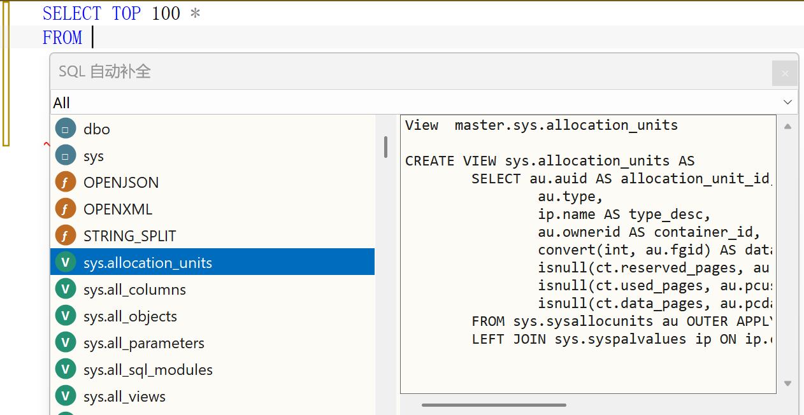
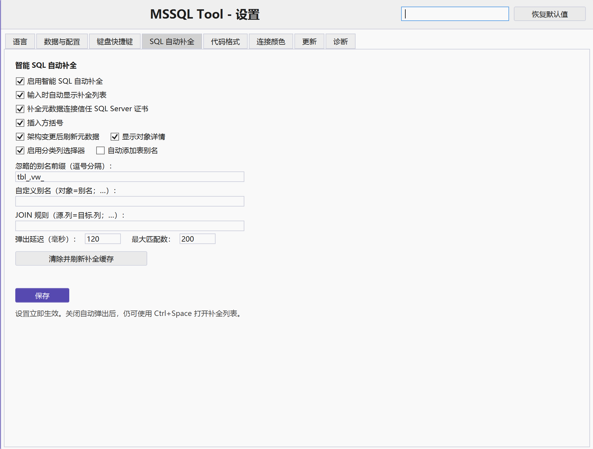
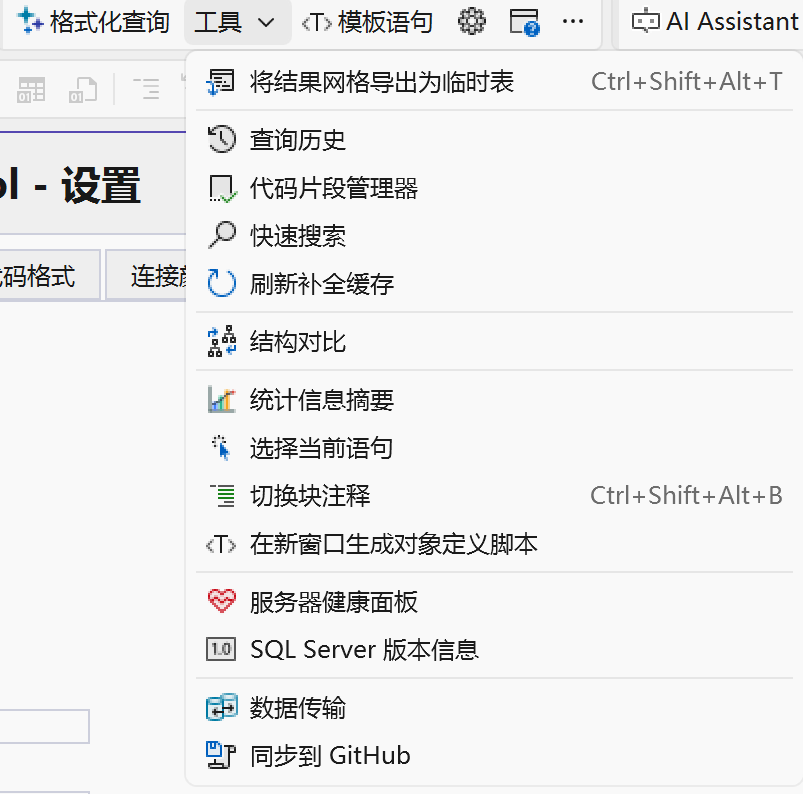

# MSSQL Tool for SSMS 22

[English](README.md) | [简体中文](README.zh-CN.md)

 

## Links

GitHub repository

https://github.com/PuLuShen/MSSQLTOOL

Latest release (ZIP + VSIX)

https://github.com/PuLuShen/MSSQLTOOL/releases/latest

SSMS Gallery (for SQL Server Management Studio)

https://ssmsgallery.azurewebsites.net/extension/MSSQLTool

VSIX Gallery (for Visual Studio)

https://www.vsixgallery.com/extension/MSSQLTool

Documentation (Wiki)

https://github.com/PuLuShen/MSSQLTOOL/wiki

## Install

1. Download the ZIP from the latest release above and run `安装或重装.cmd` (recommended).
2. Or install the newest VSIX from the SSMS Gallery above.
3. Updates are built in: **Settings -> Updates** can schedule "install when SSMS closes".

> MSSQL Tool is a free, open-source productivity extension for SQL Server Management Studio 22.
> It adds context-aware SQL completion, T-SQL formatting, query history,
> server health monitoring, and result export to Excel/Google Sheets/email.
> Built for SQL Server developers and DBAs who want faster query writing
> and richer result processing inside SSMS.

> MSSQL Tool is a fork of [Axial-SQL/AxialSqlTools](https://github.com/Axial-SQL/AxialSqlTools) (Apache-2.0). The SQL completion engine, the formatter options, and the settings and localization layers were reworked on top of it.

## Highlights

- **Full bilingual UI (中文/English)** - most SSMS extensions are English-only.
- **Free alternative to SQL Prompt** for SQL completion, T-SQL formatting, query history, and result export to Excel/email.
- **Built on Axial SQL Tools** (maintained since 2016), with an enhanced completion engine and localization.

*Note: Google Sheets export and GitHub script sync are experimental and under active development.*

## Screenshots

**Smart SQL completion** - context-aware suggestions while you type: schemas, tables, views, columns, procedures, functions and parameters, each with a kind icon, a category filter and the details of the highlighted object.

**Settings** - every feature has its own options and is saved immediately. The interface follows the SSMS language (Simplified Chinese shown here, English is available too).

**Tools menu** - the extension's commands, with their keyboard shortcuts where one is configured.

## Features

### SQL editing

- **Smart SQL completion:** Context-aware suggestions for databases, schemas, tables, views, columns, procedures, functions, parameters, synonyms, and linked-server objects.
- **Completion metadata cache:** Background loading, manual clear/refresh, loading status feedback, and optional SQL Server certificate trust.
- **F12 Go to Definition:** Opens database object definitions and navigates to local SQL definitions.
- **T-SQL formatting**
- **Query templates and snippets**
- **Expand `SELECT *` to a column list**
- **Select current statement**
- **Toggle block comments**
- **Quick Search**
- **Script object definition**

### Result processing and data transfer

- **Export grid to Excel**
- **Send grid results by email**
- **Export grid as a temporary table**
- **Copy grid column names and values as INSERT, CSV, JSON, XML, or HTML**
- **Bulk data transfer**

### Monitoring and workflow

- **Query History**
- **Server Health Dashboard**
- **Execution statistics summary**
- **Transaction and Always Encrypted warnings**
- **Connection colors for server and database environments**
- **Millisecond query execution time**
- **Right-aligned numeric grid values**
- **SQL Server version information**
- **Configurable data and settings folder** (another drive, a synced folder or a portable device)

## Experimental features

These work, but their design is still moving: expect changes between releases and re-check the
related settings after upgrading.

| Feature | Status |
| --- | --- |
| **Google Sheets export** | Beta - OAuth setup and column mapping are still changing. |
| **GitHub script sync** | Beta - whole-file push and pull, conflict resolution is manual. |

## Formatting

SSMS 22 ships its own T-SQL formatter, so **the formatting feature of this extension is no longer
developed**. The command still works and is kept for existing habits - it now lives in the
**Tools** menu (Ctrl+Shift+Alt+F) - but new formatting options will not be added.

## Support

## FAQ

**What is MSSQL Tool?**
A free SSMS 22 extension for SQL completion, formatting, and result processing.

**Is MSSQL Tool free?**
Yes, it is open-source under Apache-2.0.

**How does it compare to SQL Prompt or dbForge?**
MSSQL Tool is free and open-source, with built-in GitHub sync and Google Sheets export. SQL Prompt and dbForge are commercial alternatives.
